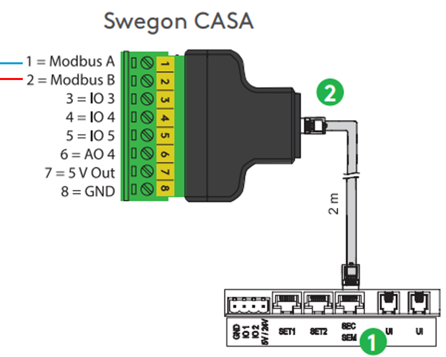
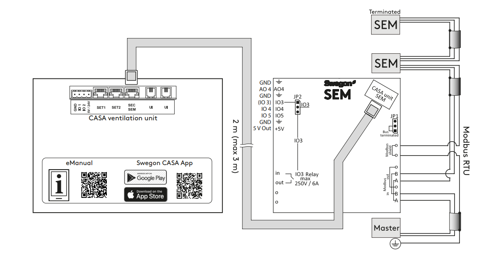

**Sprog:** [English](README.md) | [Suomi](README.fi.md) | [Svenska](README.sv.md) | [Norsk](README.no.md) | [Dansk](README.da.md)

# Swegon CASA Genius — Home Assistant-integration

Home Assistant custom component til Swegon CASA Genius-ventilationsanlægget.
Læser og styrer anlægget via Modbus RTU (RS485). ~121 entiteter:
temperaturer, luftmængder, driftstilstand, alarmer, indstillinger.

Integrationen fungerer også med nyere Swegon CASA Smart-enheder, som bruger det samme Genius-register.

> **Dette er en testversion.** Installationen foretages manuelt (endnu ikke tilgængelig via HACS).

---

## Krav

Før du går i gang, skal du bruge:

- Et **Swegon CASA Genius**-anlæg med styrekort **SCB 4.2** og software **SW 4.0 eller nyere**
  (testet på en W5 500W A-enhed, firmware 4.3.800)
- En **RS485-USB-adapter** tilsluttet anlæggets Modbus-bus og Home Assistant-serveren
  (f.eks. en CH341-baseret adapter, vises som regel som `/dev/ttyUSB0`)
- Home Assistant med adgang til mappen `custom_components` (f.eks. via Studio Code Server,
  Samba eller File Editor)

Uden den fysiske enhed og en fungerende RS485-forbindelse opretter integrationen ikke forbindelse til noget.

Alternative RS485-konvertere:
- https://raspberrypi.dk/en/product/industrial-usb-to-rs485-bidirectional-converter/
- https://www.digikey.fi/en/products/detail/olimex-ltd/USB-RS485/21661988
- https://www.amazon.com/DSD-TECH-SH-U10-Converter-Compatible/dp/B078X5H8H7

---

## Tilslutning

CASA Genius-ventilationsanlægget har en indbygget Modbus RTU-grænseflade, som føres ud via et SEC- eller SEM-tilslutningsmodul. Modulet tilsluttes "SEC/SEM"-stikket på anlæggets hovedkort med det medfølgende 2-meters kabel.

To ben på SEC/SEM-modulets klemrække bruges til Modbus-forbindelsen: ben 1 er Modbus A og ben 2 er Modbus B. Disse forbindes til en RS485-USB-konverter (f.eks. en Waveshare USB to RS485 (B)), så konverterens A+ forbindes til Modbus A og B- forbindes til Modbus B. Bogstavmatchningen A↔A, B↔B er en udbredt konvention inden for RS485, så det er et sikkert udgangspunkt — hvis forbindelsen ikke virker med det samme, kan A- og B-lederne byttes om uden risiko for skade.

| Fra | Til |
|---|---|
| Ventilationsanlægget, **SEC/SEM**-porten på hovedkortet | SEC/SEM-modulets RJ-stik, med det medfølgende kabel (2 m) |
| RS485-USB-konverterens **A+** | SEC/SEM-modulets klemme 1 (Modbus A) |
| RS485-USB-konverterens **B-** | SEC/SEM-modulets klemme 2 (Modbus B) |
| RS485-USB-konverterens GND (valgfrit) | SEC/SEM-modulets klemme 8 (GND) |
| RS485-USB-konverterens USB-stik | USB-porten på Home Assistant-enheden |

RS485-USB-konverteren tilsluttes USB-porten på den enhed, der kører Home Assistant, hvor den som regel vises som `/dev/ttyUSB0`. Det svarer også til integrationens standardindstilling for seriel port.

1. Ventilationsanlæggets tilslutningspanel
2. Swegon SEC-tilslutningsmodul



*Bemærk: der bruges ingen GND-forbindelse i denne tilslutning. Hvis buslængden øges, eller du oplever forstyrrelser, kan en fælles jordforbindelse mellem SEC/SEM-modulets ben 8 og konverterens GND-klemme forbedre pålideligheden.*

### Manualer

Installationsvejledning til CASA SEM: https://www.swegon.com/globalassets/digizuite/10062-en-casasem_installation_en.pdf

Installationsvejledning til CASA SEC: https://www.swegon.com/globalassets/digizuite/10060-en-casasec_installation_en.pdf

## Tilslutning med SEMIO-modul

SEMIO er Swegons indkapslede Modbus-modul. Det indeholder det samme SEM-kort som DIN-skinneversionen, så det har samme formål som SEC/SEM-modulet ovenfor. Forskellen er, at tilslutningerne sidder på mærkede skrueklemmer inde i boksen, ikke på det 8-polede stik med nummererede ben. **Brug A/B-mærkningen, der er trykt på kortet, ikke bennumre.**

**Før du går i gang:** sluk for ventilationsanlægget. Elinstallation skal udføres i henhold til nationale bestemmelser. IO3-relæets klemmer kan føre op til 250 V / 6 A, så hold Modbus-ledningerne væk fra dem.

### Tilslutninger

| Fra | Til |
|---|---|
| Ventilationsanlægget, **SEC/SEM**-porten på hovedkortet | SEMIO's "CASA unit"-stik, med det medfølgende kabel (2 m, maks. 3 m) |
| RS485-USB-konverterens **A+** | SEMIO Modbus **A** ("in"-parret) |
| RS485-USB-konverterens **B-** | SEMIO Modbus **B** ("in"-parret) |
| RS485-USB-konverterens USB-stik | USB-porten på Home Assistant-enheden |

Brug **"in"**-klemmerne. "Out"-parret bruges kun til at føre bussen videre til et andet SEM/SEMIO-modul.



### Jumpere

- **JP1 (busafslutning):** Swegons regel er at montere den i den sidste enhed i Modbus-kæden. Når ét enkelt SEMIO er tilsluttet direkte til konverteren, er det den sidste enhed, så sæt JP1 i positionen *Bus terminated*. Hvis forbindelsen er ustabil på et langt kabel, så kontrollér afslutningen i begge ender.
- **JP2:** lad den stå i standardpositionen. Den skal kun flyttes til IO3, hvis du bruger IO3-klemmen som digital eller analog indgang, hvilket denne integration ikke har brug for.

### Kabelskærm

Hvis du bruger skærmet kabel, så jord skærmen i **kun ét punkt**, på konverterens/Home Assistants side ("masteren"). De to skærmklemmer på SEMIO-kortet er internt forbundet med hinanden.

### Modbus-indstillinger på anlægget

SEMIO bruger anlæggets Modbus-indstillinger. På et **Genius**-betjeningspanel åbner du menuen *Idriftsættelse / (1234) / Modbus*. Fabriksværdierne svarer til integrationens standardværdier:

| Indstilling | Værdi |
|---|---|
| Adresse | 1 |
| Baudrate | 38400 |
| Stopbit | 1 |
| Paritet | ingen |

Hvis du har ændret nogen af disse, så angiv de samme værdier, når du tilføjer integrationen.

### Manual

Installationsvejledning til CASA SEMIO: https://www.swegon.com/globalassets/digizuite/10063-en-semio_installation_en.pdf

## Installation

1. Pak den modtagne pakke ud (`swegon_genius_jako.tar.gz`). Den indeholder en mappe med navnet `swegon_genius`.

2. Kopier hele mappen `swegon_genius` til Home Assistants mappe:

   ```
   /config/custom_components/swegon_genius/
   ```

   Hvis mappen `custom_components` ikke findes, så opret den først.

   Hvis du pakker pakken ud direkte på serveren i en terminal:

   ```
   cd /config/custom_components
   tar -xzf /sti/til/swegon_genius_jako.tar.gz
   ```

3. Genstart Home Assistant:

   ```
   ha core restart
   ```

---

## Fjernelse

1. Fjern integrationen fra Home Assistant:
  - Åbn "Indstillinger → Enheder og tjenester"
  - Vælg "Swegon CASA Genius"
  - Vælg **Slet** (fra menuen med tre prikker)

2. Slet integrationens mappe:
   ```
   /config/custom_components/swegon_genius/
   ```

3. Genstart Home Assistant

Integrationen, dens entiteter og alle gemte indstillinger fjernes.
> **Bemærk:** Dashboards, automatiseringer, scripts, hjælpere og skabeloner, der refererer til integrationens entiteter, **fjernes ikke automatisk**.
> Hvis de refererer til slettede entiteter, viser Home Assistant dem som *unavailable*, indtil referencerne fjernes eller opdateres.

---

## Opsætning

1. **Indstillinger → Enheder og tjenester → Tilføj integration**
2. Søg efter **"Swegon CASA Genius"**
3. Angiv forbindelsesindstillingerne. Standardværdierne passer til de fleste:

   | Indstilling | Standard | Bemærkning |
   |--------|--------|------|
   | Seriel port | `/dev/ttyUSB0` | adapterens enhedssti |
   | Slave-adresse | `1` | anlæggets Modbus-adresse (1–247) |
   | Baudrate | `38400` | |
   | Stopbit | `1` | |
   | Paritet | `N` | |

4. Gem. Hvis forbindelsen lykkes, vises entiteterne under enheden.

---

## Hvad pakken indeholder — og hvad den ikke indeholder

**Inkluderet:**
- Selve integrationen (entiteter og styringer) samt oversættelser til fem sprog (fi/en/sv/nb/da).
- Simpelt dashboard på engelsk.

**Ikke inkluderet:**
- Virkningsgrad-skabelon (LTO %) — det er en separat definition i `configuration.yaml`
- PIN-beskyttelse af blæserhastigheder — en dashboard-funktion, ikke en del af integrationen

Du får altså hovedsageligt entiteterne. Bortset fra det simple eksempel-dashboard er det dit eget arbejde at gøre dem synlige.

---

## Entitetsnavne, ID'er og sprog

Entitetsnavne følger **systemsproget** (Indstillinger → System → Generelt → Sprog), IKKE brugerprofilens sprog. Sådan fungerer Home Assistant.

Entitets-**ID'er** oprettes én gang, når en entitet tilføjes første gang. De opbygges af enhedens navn og entitetens navn **på systemsproget i det øjeblik**. For eksempel er driftstilstandsvælgeren `select.swegon_casa_genius_dev_ttyusb0_operating_mode` på engelsk og `select.swegon_casa_genius_dev_ttyusb0_kayttotila` på finsk.

Det betyder, at:
- ID'er er forskellige mellem systemer, der er installeret med forskellige sprog.
- Hvis du skifter sprog senere, ændres kun de viste navne. Eksisterende ID'er ændres ikke.
- ID'et indeholder også enhedens navn, som inkluderer den serielle port (f.eks. `dev_ttyusb0`). Hvis du bruger en anden port, er starten af ID'et anderledes.
- Et dashboard, en automatisering eller et script fra en anden bruger kan ikke bruges, som det er. Kontrollér ID'erne, og erstat dem med dine egne.

**Find dine egne ID'er:** Udviklerværktøjer → Tilstande, søg efter "swegon". Eller Indstillinger → Enheder og tjenester → Swegon CASA Genius → vælg en entitet → tandhjulsikonet. Du kan også ændre et ID derfra.

**Eksempel-dashboard:** dashboardet i mappen `dashboard/` er lavet til engelsk systemsprog og porten `/dev/ttyUSB0`. I andre opsætninger skal du erstatte ID'erne med dine egne. Hvis dit sprog er engelsk, og kun porten er anderledes, er det nok at søge og erstatte det fælles præfiks `swegon_casa_genius_dev_ttyusb0` med dit eget. Med andre sprog er slutningen af hvert ID også anderledes, så kontrollér hvert ID.

### Tilføj dashboardet

1. Gå til **Indstillinger → Dashboards → Tilføj dashboard**, vælg **Nyt dashboard fra bunden**, giv det et navn (f.eks. "Swegon CASA Genius") og vælg **Opret**.
2. Åbn det nye dashboard fra sidepanelet, og vælg **blyantikonet** (Rediger dashboard) øverst til højre.
3. Åbn **tre-prikkers-menuen**, og vælg **Raw configuration editor** (rå konfigurationseditor).
4. Åbn `dashboard/dashboard.yaml` (i pakken eller på GitHub), kopiér hele indholdet, og indsæt det i editoren, så alt, der allerede står der, erstattes.
5. Erstat entitets-ID'erne med dine egne (se ovenfor), vælg derefter **Gem**, og luk editoren.

Kort, der viser "Entity not available", har et ID, der ikke passer til dit system. Hvis dit anlæg ikke har en CO₂-sensor, så slet CO₂-kortet.

**Tilpasning:** dashboardet bruger kun Home Assistants indbyggede kort, så der er ikke brug for tilføjelser, og du kan redigere det frit. Vælg **Rediger dashboard**, og brug den visuelle editor: klik på et kort for at ændre entitet, navn, ikon eller farve, træk kortene for at arrangere dem, eller tilføj og slet kort med **+**-knappen. Du kan til enhver tid skifte tilbage til den rå konfigurationseditor.


---

## Fejlfinding

**"Forbindelsen mislykkedes — kontrollér kablet, slave-adressen og den serielle port"**

- Tjek adapteren? I en terminal: `ls -l /dev/ttyUSB*`
  Hvis intet vises, er adapteren ikke tilsluttet, eller driveren blev ikke genkendt.
- Er den serielle port korrekt? På nogle systemer er den `/dev/ttyUSB1` eller `/dev/ttyACM0`.
- Er slave-adressen korrekt? Tjek Modbus-indstillingerne på anlæggets betjeningspanel.
- Er baudraten den samme som anlæggets? Standard er 38400, men den kan være 9600 eller 19200.
- Vender busledningens A/B den rigtige vej? Hvis du er i tvivl, så prøv at bytte A↔B.

**Entiteter forbliver "unavailable"**

- Kontrollér, at adapteren og kablet forbliver tilsluttet.
- Tjek loggene: Indstillinger → System → Logs, søg efter "swegon".

---

## Feedback

Dette er en testversion. Fortæl, hvad der virker, hvad der ikke gør, og hvilket
anlæg/firmware du har testet med — det hjælper med at gøre den færdig.
