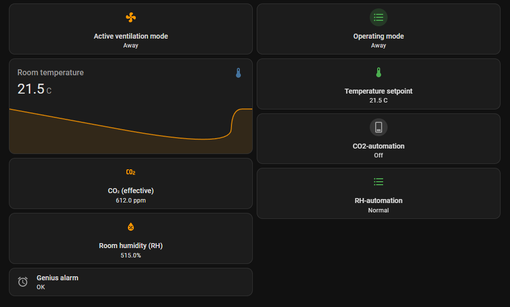

**Languages:** [English](README.md) | [Suomi](README.fi.md) | [Svenska](README.sv.md) | [Norsk](README.no.md) | [Dansk](README.da.md)

# Swegon CASA Genius — Home Assistant integration

Home Assistant custom component for the Swegon CASA Genius ventilation unit.
Reads and controls the unit over Modbus RTU (RS485). ~121 entities:
temperatures, airflows, operating mode, alarms, settings.

This integration also works with newer Swegon CASA Smart -devices, which use the same Genius register.

> **This is a test version.** Installation is manual (not yet available via HACS).

---

## Requirements

Before you start, you'll need:

- A **Swegon CASA Genius** unit with an **SCB 4.2** control board and **SW 4.0 or newer** firmware
  (tested on a W5 500W A unit, firmware 4.3.800)
- An **RS485-USB adapter** connected to the unit's Modbus bus and to the Home Assistant server
  (e.g. a CH341-based adapter, usually shows up as `/dev/ttyUSB0`)
- Home Assistant with access to the `custom_components` folder (e.g. via Studio Code Server,
  Samba, or File Editor)

Without the physical unit and a working RS485 connection, the integration won't connect to anything.

Alternative RS485 converters:
- https://raspberrypi.dk/en/product/industrial-usb-to-rs485-bidirectional-converter/
- https://www.digikey.fi/en/products/detail/olimex-ltd/USB-RS485/21661988
- https://www.amazon.com/DSD-TECH-SH-U10-Converter-Compatible/dp/B078X5H8H7

---

## Wiring

The CASA Genius ventilation unit has a built-in Modbus RTU interface, brought out through an SEC or SEM connection module. The module connects to the "SEC/SEM" connector on the unit's main board using the included 2-metre cable.

Two pins on the SEC/SEM module's terminal block are used for the Modbus connection: pin 1 is Modbus A and pin 2 is Modbus B. These connect to an RS485-USB converter (e.g. a Waveshare USB to RS485 (B)) so that the converter's A+ terminal connects to Modbus A, and B- connects to Modbus B. The A↔A, B↔B letter matching is a widely followed convention in RS485, so this is a safe starting point — if the connection doesn't come up, the A and B wires can be swapped with no risk of damage.

| From | To |
|---|---|
| Ventilation unit, **SEC/SEM** port on the main board | SEC/SEM module’s RJ socket, using the included cable (2 m) |
| RS485-USB converter **A+** | SEC/SEM terminal 1 (Modbus A) |
| RS485-USB converter **B-** | SEC/SEM terminal 2 (Modbus B) |
| RS485-USB converter GND (optional) | SEC/SEM terminal 8 (GND) |
| RS485-USB converter USB plug | USB port of the Home Assistant device |

The RS485-USB converter plugs into the USB port of the device running Home Assistant, where it typically shows up as `/dev/ttyUSB0`. This also matches the integration's default serial port setting.

1. Ventilation unit's connection panel
2. Swegon SEC connection module


*Note: a GND connection is not used in this wiring. If the bus run gets longer or you experience interference, connecting SEC/SEM pin 8 to the converter's GND terminal for a common ground can improve reliability.*

### Manuals

CASA SEM installation instructions: https://www.swegon.com/globalassets/digizuite/10062-en-casasem_installation_en.pdf

CASA SEC installation instructions: https://www.swegon.com/globalassets/digizuite/10060-en-casasec_installation_en.pdf

## Wiring with a SEMIO module

SEMIO is Swegon's boxed Modbus module. It contains the same SEM board as the DIN-rail version, so it serves the same purpose as the SEC/SEM module above. The difference is that the connections are on labelled screw terminals inside the box, not on the 8-pin plug with numbered pins. **Use the A/B labels printed on the board, not pin numbers.**

**Before you start:** switch off the ventilation unit. Electrical installation must be done according to national regulations. The IO3 relay terminals can carry up to 250 V / 6 A, so keep the Modbus wiring away from them.

### Connections

| From | To |
|---|---|
| Ventilation unit, **SEC/SEM** port on the main board | SEMIO's "CASA unit" socket, using the included cable (2 m, max 3 m) |
| RS485-USB converter **A+** | SEMIO Modbus **A** (the "in" pair) |
| RS485-USB converter **B-** | SEMIO Modbus **B** (the "in" pair) |
| RS485-USB converter USB plug | USB port of the Home Assistant device |

Use the **"in"** terminals. The "out" pair is only for continuing the bus to another SEM/SEMIO module.


### Jumpers

- **JP1 (bus termination):** Swegon's rule is to install this in the last unit of the Modbus chain. With one SEMIO connected directly to the converter, it is the last unit, so set JP1 to *Bus terminated*. If the connection is unreliable on a long cable, check termination at both ends.
- **JP2:** leave in its default position. It only needs to move to IO3 if you use the IO3 terminal as a digital or analogue input, which this integration does not need.

### Cable shield

If you use shielded cable, ground the shield at **one point only**, on the converter/Home Assistant side (the "master"). The two shield terminals on the SEMIO board are connected to each other internally.

### Modbus settings on the unit

The SEMIO uses the unit's Modbus settings. On a **Genius** control panel, open the menu *Commissioning / (1234) / Modbus*. The factory values match the integration's defaults:

| Setting | Value |
|---|---|
| Address | 1 |
| Baud rate | 38400 |
| Stop bits | 1 |
| Parity | none |

If you have changed any of these, enter the same values when you add the integration.

### Manual

CASA SEMIO installation instructions: https://www.swegon.com/globalassets/digizuite/10063-en-semio_installation_en.pdf

## Installation

1. Extract the package you received (`swegon_genius_jako.tar.gz`). It contains a folder named `swegon_genius`.

2. Copy the whole `swegon_genius` folder into Home Assistant's folder:

   ```
   /config/custom_components/swegon_genius/
   ```

   If the `custom_components` folder doesn't exist yet, create it first.

   If you're extracting the package directly on the server in a terminal:

   ```
   cd /config/custom_components
   tar -xzf /path/to/swegon_genius_jako.tar.gz
   ```

3. Restart Home Assistant:

   ```
   ha core restart
   ```

---

## Removal

1. Remove the integration from Home Assistant:
  - Open "Settings → Devices & services"
  - Select "Swegon CASA Genius"
  - Select **Delete** (from the three-dot menu)

2. Delete the integration's folder:
   ```
   /config/custom_components/swegon_genius/
   ```

3. Restart Home Assistant

The integration, its entities, and all saved settings are removed.
> **Note:** Dashboards, automations, scripts, helpers, and templates that reference the integration's entities **are not removed automatically**.
> If they reference deleted entities, Home Assistant will show them as *unavailable* until the references are removed or updated.

---

## Setup

1. **Settings → Devices & services → Add integration**
2. Search for **"Swegon CASA Genius"**
3. Enter the connection settings. The defaults suit most setups:

   | Setting | Default | Note |
   |--------|--------|------|
   | Serial port | `/dev/ttyUSB0` | adapter's device path |
   | Slave address | `1` | the unit's Modbus address (1–247) |
   | Baud rate | `38400` | |
   | Stop bits | `1` | |
   | Parity | `N` | |

4. Save. If the connection succeeds, entities will appear under the device.

---

## What's in the package — and what's not

**Included:** 
- The integration itself (entities and controls), plus translations for five languages (fi/en/sv/nb/da).
- Basic dashboard in english.

**Not included:**
- Efficiency template (LTO %) — that's a separate `configuration.yaml` definition
- PIN protection for fan speeds — a dashboard-level feature, not part of the integration

So you mainly get the entities. Apart from the basic example dashboard, making them visible is your own work.

---

## Entity names, IDs and languages

Entity **names** follow the **system language** (Settings → System → General → Language), NOT the user profile's language. This is how Home Assistant works.

Entity **IDs** are created once, when an entity is first added. They are built from the device name and the entity name **in the system language at that moment**. For example, the operating mode select is `select.swegon_casa_genius_dev_ttyusb0_operating_mode` in English and `select.swegon_casa_genius_dev_ttyusb0_kayttotila` in Finnish.

This means:
- IDs differ between systems installed with different languages.
- Changing the language later only changes the displayed names. Existing IDs do not change.
- The ID also contains the device name, which includes the serial port (e.g. `dev_ttyusb0`). If you use another port, the start of the ID is different.
- A dashboard, automation or script from another user can't be used as-is. Check the IDs and replace them with your own.

**Finding your own IDs:** Developer tools → States, search for "swegon". Or Settings → Devices & services → Swegon CASA Genius → select an entity → gear icon. You can also rename an ID from that view.

**Example dashboard:** the dashboard in the `dashboards/` folder is written for an English system language and the port `/dev/ttyUSB0`. In other setups, replace the IDs with your own. If your language is English and only the port differs, it is enough to find and replace the common prefix `swegon_casa_genius_dev_ttyusb0` with yours. With other languages the end of each ID is different too, so check every ID.



---

## Troubleshooting

**"Connection failed — check the cable, slave address, and serial port"**

- Check the adapter? In a terminal: `ls -l /dev/ttyUSB*`
  If nothing shows up, the adapter isn't connected or the driver wasn't recognized.
- Is the serial port correct? On some systems it's `/dev/ttyUSB1` or `/dev/ttyACM0`.
- Is the slave address correct? Check the Modbus settings on the unit's control panel.
- Is the baud rate the same as the unit's? Default is 38400, but it could be 9600 or 19200.
- Is the bus cable's A/B the right way round? If unsure, try swapping A↔B.

**Entities stay "unavailable"**

- Check that the adapter and cable stay connected.
- Check the logs: Settings → System → Logs, search for "swegon".

---

## Feedback

This is a test version. Let me know what works, what doesn't, and which unit/firmware
you tested with — it helps with finalizing it.
