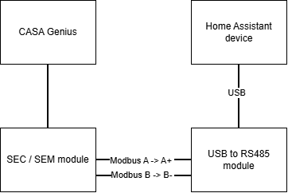

**Språk:** [English](README.md) | [Suomi](README.fi.md) | [Svenska](README.sv.md) | [Norsk](README.no.md) | [Dansk](README.da.md)

# Swegon CASA Genius — Home Assistant-integration

Home Assistant custom component för Swegon CASA Genius-ventilationsaggregatet.
Läser och styr aggregatet via Modbus RTU (RS485). ~121 entiteter:
temperaturer, luftflöden, driftläge, larm, inställningar.

> **Detta är en testversion.** Installationen görs manuellt (ännu inte tillgänglig via HACS).

---

## Krav

Innan du börjar behöver du:

- Ett **Swegon CASA Genius**-aggregat med styrkort **SCB 4.2** och mjukvara **SW 4.0 eller nyare**
  (testat på en W5 500W A-enhet, firmware 4.3.800)
- En **RS485-USB-adapter** ansluten till aggregatets Modbus-buss och till Home Assistant-servern
  (t.ex. en CH341-baserad adapter, visas oftast som `/dev/ttyUSB0`)
- Home Assistant med åtkomst till mappen `custom_components` (t.ex. via Studio Code Server,
  Samba eller File Editor)

Utan den fysiska enheten och en fungerande RS485-anslutning ansluter integrationen inte till något.

Alternativa RS485-omvandlare:
- https://raspberrypi.dk/en/product/industrial-usb-to-rs485-bidirectional-converter/
- https://www.digikey.fi/en/products/detail/olimex-ltd/USB-RS485/21661988
- https://www.amazon.com/DSD-TECH-SH-U10-Converter-Compatible/dp/B078X5H8H7

---

## Inkoppling

CASA Genius-ventilationsaggregatet har ett inbyggt Modbus RTU-gränssnitt som tas ut via en SEC- eller SEM-anslutningsmodul. Modulen ansluts till kontakten "SEC/SEM" på aggregatets huvudkort med den medföljande 2-meterskabeln.

Två stift på SEC/SEM-modulens kopplingsplint används för Modbus-anslutningen: stift 1 är Modbus A och stift 2 är Modbus B. Dessa ansluts till en RS485-USB-omvandlare (t.ex. en Waveshare USB to RS485 (B)) så att omvandlarens A+ ansluts till Modbus A och B- till Modbus B. Bokstavsmatchningen A↔A, B↔B är en allmänt följd konvention inom RS485, så detta är en säker utgångspunkt — om anslutningen inte fungerar direkt kan A- och B-ledarna bytas utan risk för skada.

RS485-USB-omvandlaren ansluts till USB-porten på enheten som kör Home Assistant, där den oftast visas som `/dev/ttyUSB0`. Detta motsvarar också integrationens standardinställning för seriell port.

1. Ventilationsaggregatets anslutningspanel
2. Swegon SEC-anslutningsmodul




*Obs: en GND-anslutning används inte i denna inkoppling. Om bussträckan blir längre eller du upplever störningar kan en gemensam jord mellan SEC/SEM-modulens stift 8 och omvandlarens GND-kontakt förbättra tillförlitligheten.*

## Installation

1. Packa upp paketet du fått (`swegon_genius_jako.tar.gz`). Där finns en mapp som heter `swegon_genius`.

2. Kopiera hela mappen `swegon_genius` till Home Assistants mapp:

   ```
   /config/custom_components/swegon_genius/
   ```

   Om mappen `custom_components` inte finns, skapa den först.

   Om du packar upp paketet direkt på servern i en terminal:

   ```
   cd /config/custom_components
   tar -xzf /sökväg/swegon_genius_jako.tar.gz
   ```

3. Starta om Home Assistant:

   ```
   ha core restart
   ```

---

## Avinstallation

1. Ta bort integrationen från Home Assistant:
  - Öppna "Inställningar → Enheter och tjänster"
  - Välj "Swegon CASA Genius"
  - Välj **Ta bort** (från menyn med tre punkter)

2. Ta bort integrationens mapp:
   ```
   /config/custom_components/swegon_genius/
   ```

3. Starta om Home Assistant

Integrationen, dess entiteter och alla sparade inställningar tas bort.
> **Obs:** Dashboards, automationer, skript, hjälpare och mallar som refererar till integrationens entiteter **tas inte bort automatiskt**.
> Om de refererar till borttagna entiteter visar Home Assistant dem som *unavailable* tills referenserna tas bort eller uppdateras.

---

## Driftsättning

1. **Inställningar → Enheter och tjänster → Lägg till integration**
2. Sök efter **"Swegon CASA Genius"**
3. Ange anslutningsinställningarna. Standardvärdena passar de flesta:

   | Inställning | Standard | Obs |
   |--------|--------|------|
   | Seriell port | `/dev/ttyUSB0` | adapterns enhetssökväg |
   | Slav-adress | `1` | aggregatets Modbus-adress (1–247) |
   | Baudrate | `38400` | |
   | Stoppbitar | `1` | |
   | Paritet | `N` | |

4. Spara. Om anslutningen lyckas visas entiteterna under enheten.

---

## Vad paketet innehåller — och vad det INTE innehåller

**Ingår:** själva integrationen (entiteter och styrningar) samt översättningar
för fem språk (fi/en/sv/nb/da).

**Ingår INTE:**
- Dashboard-/gränssnittskort — endast en enkel exempeldashboard (på engelska) finns i `dashboards/`; bygg din egen för mer
- Verkningsgrad-mall (LTO %) — det är en separat definition i `configuration.yaml`
- PIN-skydd för fläkthastigheter — en dashboard-funktion, inte en del av integrationen

Du får alltså huvudsakligen entiteterna. Bortsett från den enkla exempeldashboarden är det ditt eget jobb att göra dem synliga.

---

## Entitetsnamn, ID:n och språk

Entitetsnamnen följer **systemspråket** (Inställningar → System → Allmänt → Språk), INTE användarprofilens språk. Så fungerar Home Assistant.

Entitets-**ID:n** skapas en gång, när en entitet läggs till första gången. De byggs av enhetens namn och entitetens namn **på systemspråket vid det tillfället**. Till exempel är driftlägesväljaren `select.swegon_casa_genius_dev_ttyusb0_operating_mode` på engelska och `select.swegon_casa_genius_dev_ttyusb0_kayttotila` på finska.

Det innebär att:
- ID:n skiljer sig mellan system som installerats med olika språk.
- Om du byter språk i efterhand ändras bara de visade namnen. Befintliga ID:n ändras inte.
- ID:t innehåller också enhetens namn, som inkluderar den seriella porten (t.ex. `dev_ttyusb0`). Om du använder en annan port är början av ID:t annorlunda.
- En dashboard, automation eller ett skript från en annan användare kan inte användas som det är. Kontrollera ID:n och ersätt dem med dina egna.

**Hitta dina egna ID:n:** Utvecklarverktyg → Tillstånd, sök efter "swegon". Eller Inställningar → Enheter och tjänster → Swegon CASA Genius → välj en entitet → kugghjulsikonen. Du kan också byta namn på ett ID därifrån.

**Exempeldashboard:** dashboarden i mappen `dashboards/` är gjord för engelskt systemspråk och porten `/dev/ttyUSB0`. I andra fall ersätter du ID:n med dina egna. Om ditt språk är engelska och bara porten skiljer sig räcker det att söka och ersätta det gemensamma prefixet `swegon_casa_genius_dev_ttyusb0` med ditt eget. Med andra språk skiljer sig även slutet av varje ID, så kontrollera varje ID.

---

## Felsökning

**"Anslutningen misslyckades — kontrollera kabeln, slav-adressen och den seriella porten"**

- Kontrollera adaptern? I en terminal: `ls -l /dev/ttyUSB*`
  Om inget visas är adaptern inte ansluten eller så identifierades inte drivrutinen.
- Är den seriella porten korrekt? På vissa system är den `/dev/ttyUSB1` eller `/dev/ttyACM0`.
- Är slav-adressen korrekt? Kontrollera Modbus-inställningarna på aggregatets kontrollpanel.
- Är baudraten densamma som aggregatets? Standard är 38400, men den kan vara 9600 eller 19200.
- Är bussens A/B rättvänt? Om du är osäker, prova att byta A↔B.

**Entiteter förblir "unavailable"**

- Kontrollera att adaptern och kabeln förblir anslutna.
- Kolla loggarna: Inställningar → System → Loggar, sök efter "swegon".

---

## Feedback

Detta är en testversion. Berätta vad som fungerar, vad som inte gör det, och vilket
aggregat/firmware du testat med — det hjälper till med färdigställandet.
